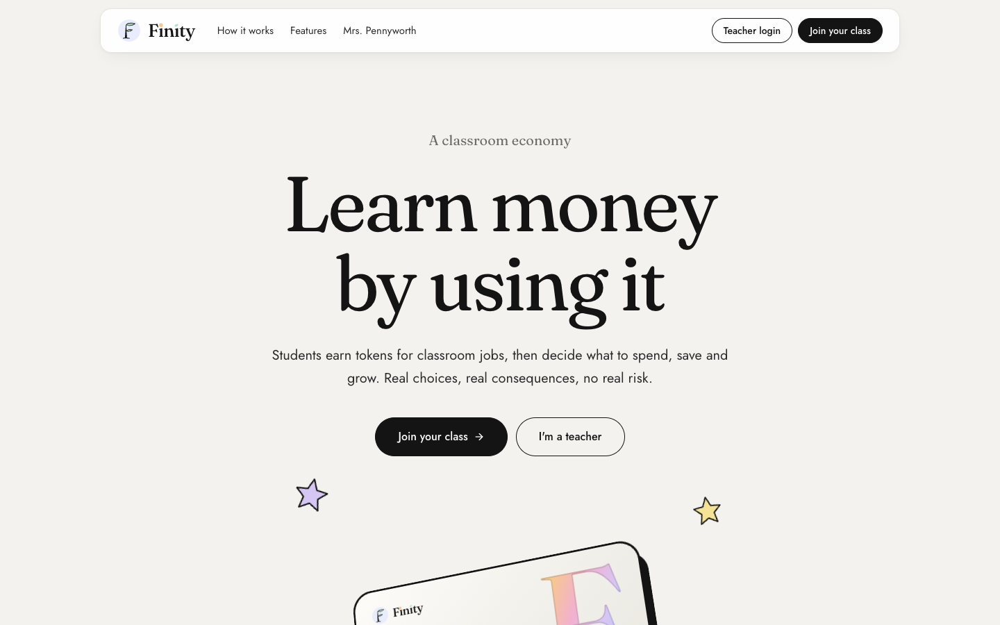
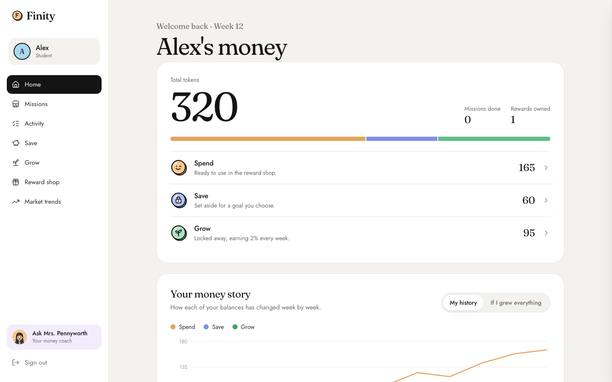
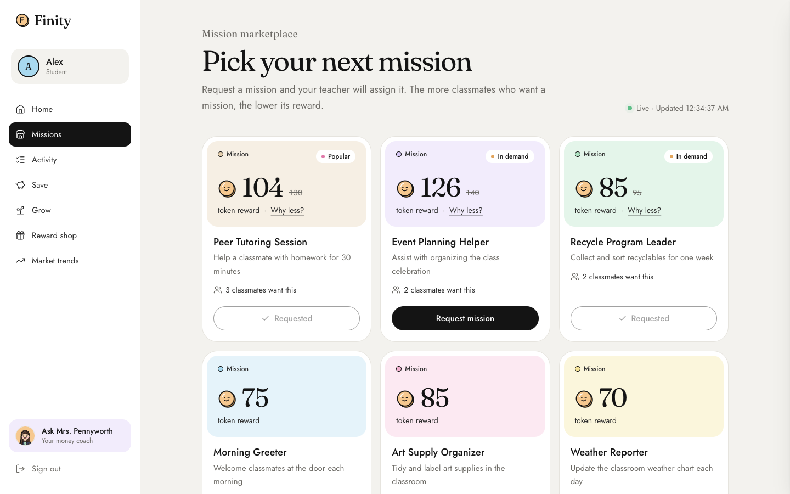
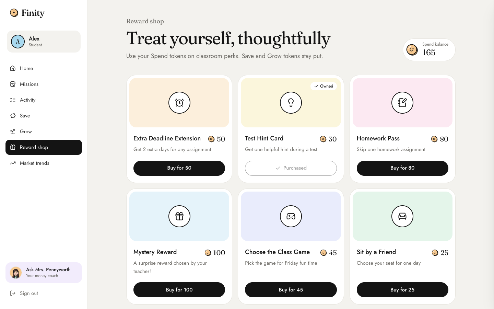
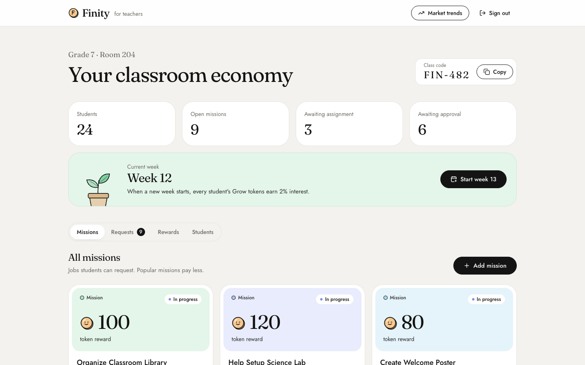
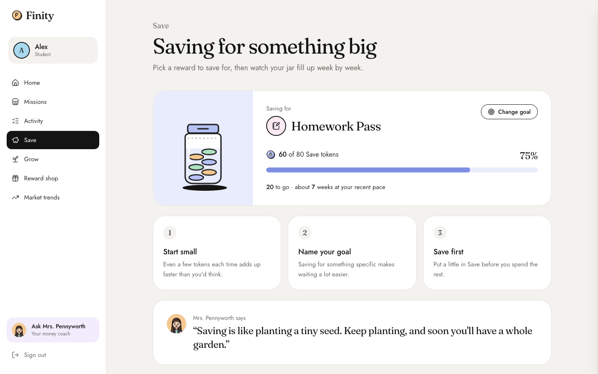
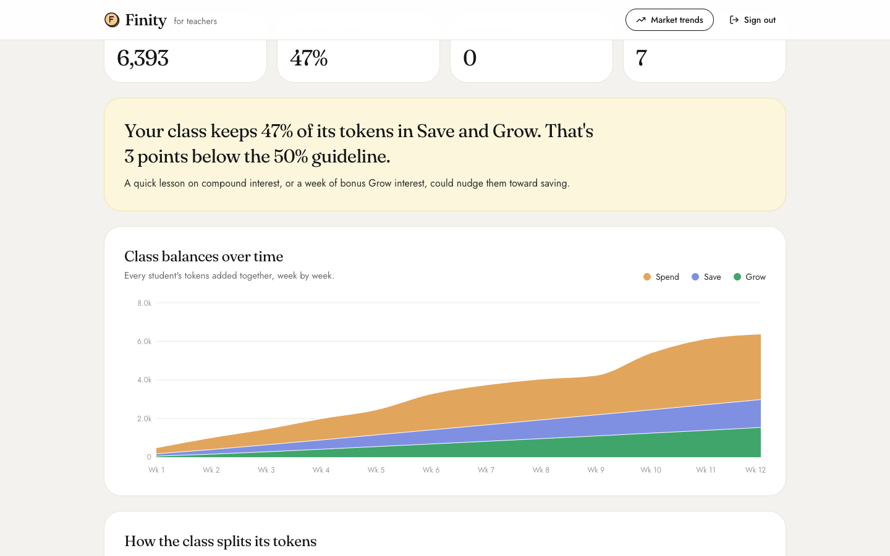
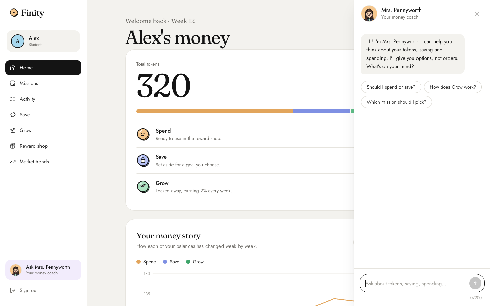
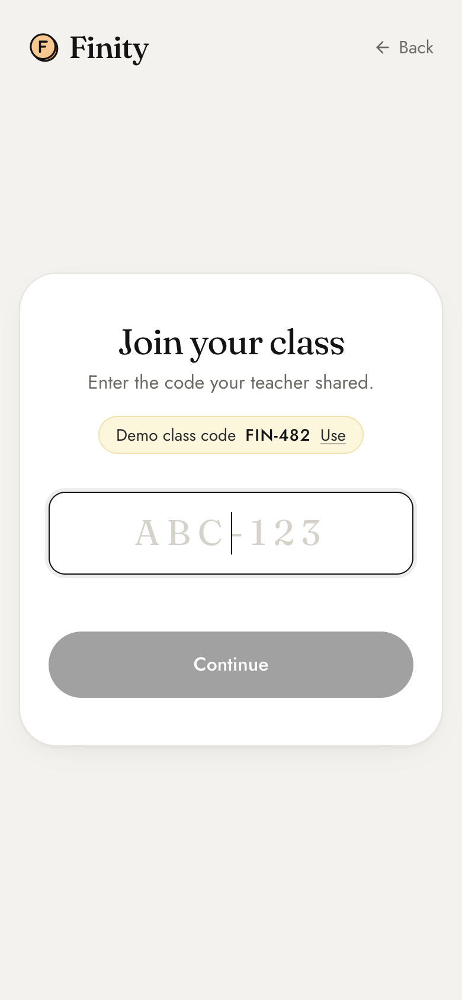

## Overview

In Canada, 64% of people say they never learned financial literacy in school, and 84% believe learning it earlier would have reduced their financial stress.

Starting September 2026, students will be required to meet a new financial literacy graduation requirement in their Grade 10 math course. While financial literacy is becoming more common in classrooms, traditional lessons often do not stick.

**Finity changes that by letting students learn by doing.**

Through a classroom economy, students experience real-world money concepts like supply and demand, saving toward goals, and compound growth before the stakes are real. Instead of memorizing terms, they build habits and confidence through hands-on decisions.

Finity turns financial literacy from a one-time lesson into a daily experience, helping students build valuable financial skills that reduce future stress and support smarter money decisions for life.



## Key Features

- **Mission marketplace** with supply-and-demand pricing: the more classmates want a mission, the less it pays
- **Three-token system:** Spend, Save and Grow, with 2% weekly compound interest on Grow
- **Real weekly economy:** teachers start each new week, interest is paid out, and every student's money history and activity feed update
- **Save toward a real reward:** students pick a reward, watch a jar fill up, see how many weeks are left at their pace, then buy it with their savings
- Growth projections and a "what if I grew everything?" chart
- **Reward shop** with classroom perks
- **My room:** students decorate their own doodle room with Spend tokens; bigger items (like a pet) take saving, and can be set as a savings goal
- **Teacher dashboard** to create missions and rewards, assign and approve work, adjust balances and reset PINs
- **Class insights:** class balances over time, the class's split vs. the 50/20/30 guideline, and each student's saving habits
- **Class-code sign-in:** students enter a code, find their name and use a PIN, with no student emails needed
- **Mrs. Pennyworth**, an AI money coach powered by Gemini 2.5 Flash, with built-in fallback answers

## Screenshots

| Student home | Mission marketplace |
| --- | --- |
|  |  |
| **Reward shop** | **Teacher dashboard** |
|  |  |
| **Saving toward a reward** | **Class insights** |
|  |  |
| **Mrs. Pennyworth** | **Joining a class (mobile)** |
|  |  |

## Tech Stack

- Next.js 16 (App Router)
- TypeScript
- Tailwind CSS v4
- Recharts
- Gemini 2.5 Flash
- Vitest

## Installation & Setup

**Clone the Repo**

```bash
git clone https://github.com/Mariaakhtar0035/Finity.git
```

**Install Dependencies**

```bash
npm install
```

**Environment Variables**

Create `.env.local` in the project root with your Gemini API key:

```
GEMINI_API_KEY=your_key_here
```

The AI is optional: without a key, Mrs. Pennyworth falls back to built-in answers.

**Run the App**

```bash
npm run dev
```

Open http://localhost:3000. Students join with class code `FIN-482`, then pick their name. Every PIN (students and teacher) is `1234`.

**Run the Tests**

```bash
npm test
```

## How the demo works

This is a showcase build, so there's no database or real accounts:

- All classroom data lives in the visitor's browser (`localStorage`), so everyone gets their own sandbox and progress survives a refresh.
- Teacher and student tabs in the same browser stay in sync, so you can approve a mission as the teacher in one tab and claim it as the student in another.
- Visiting `/?reset` restores the starting data in that browser. There's no button for it in the UI.
- The AI routes are rate limited per visitor (25 requests per 10 minutes) to protect your API budget.

## Deploying

The easiest host is [Vercel](https://vercel.com):

1. Push the repo to GitHub, then import it at vercel.com/new. The defaults work for Next.js.
2. Under **Settings → Environment Variables**, add `GEMINI_API_KEY`.
3. Deploy. You'll get a public URL to share.

The in-app rate limit is a speed bump, not a guarantee, so also set a budget or quota on your Google AI Studio account.
